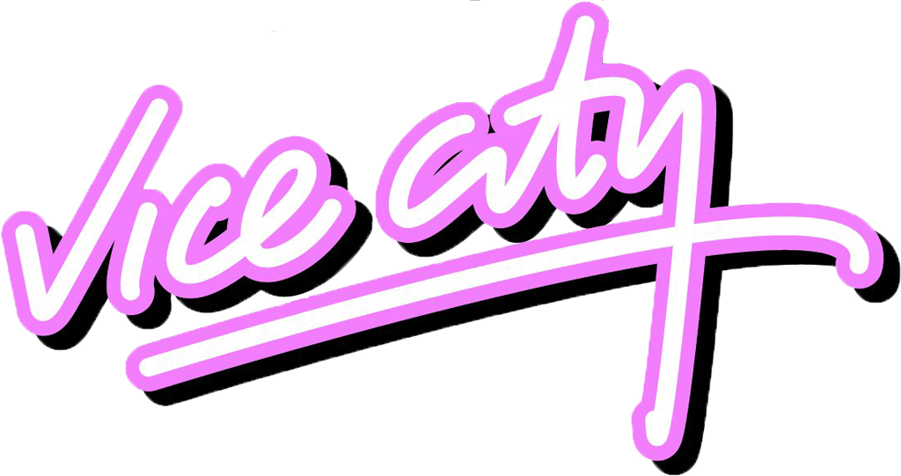

 

  

<h1 align="center">ViceX</h1>
<h3 align="center">INDEPENDENT XBOX-TO-PC COMPATIBILITY RESEARCH PROJECT</h3>

  Researching runtime compatibility, executable loading and graphics translation for PC environments.

  
  
  
  

⸻

01 — PROJECT OVERVIEW

ViceX is an independent research and development project focused on exploring the technical foundations required to run Xbox-oriented software environments on PC hardware.

The project investigates the development of a compatibility runtime capable of handling executable loading, system interfaces, graphics translation and hardware interaction.

Rather than modifying original game files, ViceX aims to develop an independent compatibility infrastructure around the software execution environment.

The project is currently under active development.

Its architecture, components and implementation are being developed through structured engineering missions, technical reports and incremental validation.

Project vision

Objective	Description
Runtime independence	Develop an independent execution and compatibility environment
Executable infrastructure	Research PE loading and executable compatibility
Graphics translation	Investigate Direct3D and Vulkan interoperability
Shader infrastructure	Develop shader identification, translation and management
System compatibility	Reproduce selected operating-system and platform interfaces
Performance research	Investigate efficient execution on modern PC hardware

⸻

02 — TECHNICAL ARCHITECTURE

ViceX is designed as a modular software architecture.

Each subsystem has a specific responsibility and can be developed, tested and documented independently.

Core components

Subsystem	Main responsibility	Current status
PE Loader	Executable loading infrastructure	In development
Runtime Core	Runtime initialization and management	In development
Registry Shims	Registry compatibility and resolution	Selected implementation work completed
DXGI Loader	DXGI module loading and safety	Documented safety work completed
DXGI Compatibility	Graphics interface compatibility	In development
D3D12 Compatibility	Direct3D 12 infrastructure	In development
Vulkan Backend	Vulkan rendering infrastructure	In development
Shader System	Shader identification and translation	In development
Export Resolution	Export names, ordinals and typed resolution	Improvements implemented

Statuses describe individual development areas, not complete end-to-end compatibility.

Graphics translation architecture

The intended graphics architecture is organized around this conceptual pipeline:

       XBOX-ORIENTED SOFTWARE
                 |
                 v
          RUNTIME CORE
                 |
                 v
        COMPATIBILITY LAYER
                 |
                 v
           DXGI / D3D12
                 |
                 v
       GRAPHICS TRANSLATION
                 |
                 v
              VULKAN
                 |
                 v
           PC HARDWARE

The complete pipeline is an architectural objective. Its full operation has not yet been demonstrated.

⸻

03 — ENGINEERING PROGRESS

Development is organized into missions with explicit objectives, implementation boundaries and validation requirements.

Selected development milestones

Mission	Engineering area	Result
12A	Shader index documentation	Completed
12C.3	DXGI loader safety	Completed with limitations
12C.3	Export resolution	Name/ordinal collision handling addressed
12C.3	Registry infrastructure	Typed ExportKey implementation documented

Current project situation

Area	Current situation	What it means
Architecture	Modular architecture under development	Core design is being progressively established
Loader	Development ongoing	Complete executable compatibility is not established
DXGI	Selected safety work completed	Further compatibility implementation is required
D3D12	Under development	Full graphics compatibility is not demonstrated
Vulkan	Under development	Complete rendering integration remains unverified
Shaders	Infrastructure under development	Complete shader translation is not established
Runtime integration	Not yet demonstrated end-to-end	The entire system has not been validated together
GTA VI execution	Not demonstrated	No successful complete game launch is claimed

Engineering standards

Every significant change should provide:

Requirement	Purpose
Implementation evidence	Demonstrate what was actually changed
Validation results	Confirm expected behaviour
Safety analysis	Identify possible regressions
Technical report	Preserve development history
Limitations	Explicitly document unfinished work

The project does not consider a component complete merely because its documentation has been written.

⸻

04 — GRAPHICS & SHADER INFRASTRUCTURE

Graphics compatibility is one of the most technically demanding areas of ViceX.

The project investigates the interaction between graphics interfaces, shader formats and GPU execution environments.

Graphics technologies

Technology	Research area
Direct3D 12	Graphics API compatibility
DXGI	Graphics infrastructure and resource handling
Vulkan	Potential graphics backend
SPIR-V	Intermediate shader representation
Shader indexing	Identification and retrieval
GPU drivers	Hardware and driver compatibility

Shader management

The shader infrastructure investigates multiple identification mechanisms, including:

* Shader-stage identification.
* fssm_sha256-based indexing.
* fspx_code_sha256-based indexing.
* Deterministic shader lookup.
* SPIR-V file management.

These mechanisms are being developed and validated incrementally.

⸻

05 — DEVELOPMENT ROADMAP

The roadmap represents the intended engineering direction, not guaranteed release dates.

Phase	Development objective	State
01	Core architecture	In progress
02	Executable loading	In progress
03	Runtime compatibility	In progress
04	DXGI infrastructure	In progress
05	D3D12 compatibility	In progress
06	Vulkan backend	Planned / in development
07	Shader translation	In progress
08	Runtime integration	Planned
09	Hardware validation	Planned
10	Performance optimization	Planned
11	Experimental release	Planned

⸻

06 — HARDWARE & PERFORMANCE TARGETS

ViceX investigates compatibility with modern PC hardware.

Hardware targets

Component	Target
Operating environment	Windows PC
GPU architecture	Modern AMD and NVIDIA GPUs
Graphics backend	Vulkan
CPU	Modern x86-64 processors
Memory	Dependent on runtime and software requirements
Storage	Dependent on software requirements

Performance objectives

The project aims to investigate:

* Efficient CPU execution.
* GPU resource management.
* Shader compilation overhead.
* Graphics translation overhead.
* Memory management.
* Frame-time stability.
* Multi-GPU-driver compatibility.

No guaranteed FPS, hardware compatibility or successful GTA VI execution is currently claimed.

⸻

07 — PROJECT GALLERY

Visual documentation will be added as development progresses.

Image	Description
grand_theft_auto_vice_city_text_logo_by_95wolfie95_dcg8jdj.png	Official project visual
leonida-architecture.png	Runtime architecture
leonida-development.png	Development environment
leonida-graphics.png	Graphics infrastructure

⸻

08 — REPOSITORY STRUCTURE

The repository will progressively contain the implementation, technical documentation, development reports and validation material.

ViceX/
│
├── README.md
│
├── docs/
│   ├── architecture/
│   ├── graphics/
│   ├── runtime/
│   └── assets/
│
├── runtime/
├── loader/
├── graphics/
├── shaders/
├── compatibility/
├── tests/
└── reports/

This is the intended repository organization. Directories and source files will be added as they become available.

⸻

09 — INDEPENDENCE & LEGAL NOTICE

ViceX is an independent research and development project.

It is not affiliated with, endorsed by or officially connected to:

* Rockstar Games
* Take-Two Interactive
* Microsoft
* Xbox

All trademarks belong to their respective owners.

The project aims to maintain independently developed source code and properly licensed dependencies.

No proprietary game files, unauthorized game copies or copyrighted executable distributions are intended to be included in this repository.

⸻

10 — DEVELOPMENT PHILOSOPHY

ViceX is guided by three fundamental principles.

Principle	Meaning
INDEPENDENCE	Build and maintain an independent software architecture
VERIFIABILITY	Support technical claims with reproducible evidence
ENGINEERING	Prioritize correctness, reliability and stability

Every milestone should move the project closer to a functional and independently verifiable compatibility environment.

⸻

11 — FINAL OBJECTIVE

The long-term ambition of ViceX is to develop an experimental Xbox-to-PC compatibility environment.

Achieving this requires substantial engineering work across executable loading, runtime interfaces, graphics translation, shader management and hardware compatibility.

The project remains experimental.

A complete successful execution of GTA VI has not yet been demonstrated.

⸻

  <strong>ViceX</strong>

  INDEPENDENT RESEARCH · INDEPENDENT ENGINEERING · CONTINUOUS DEVELOPMENT

